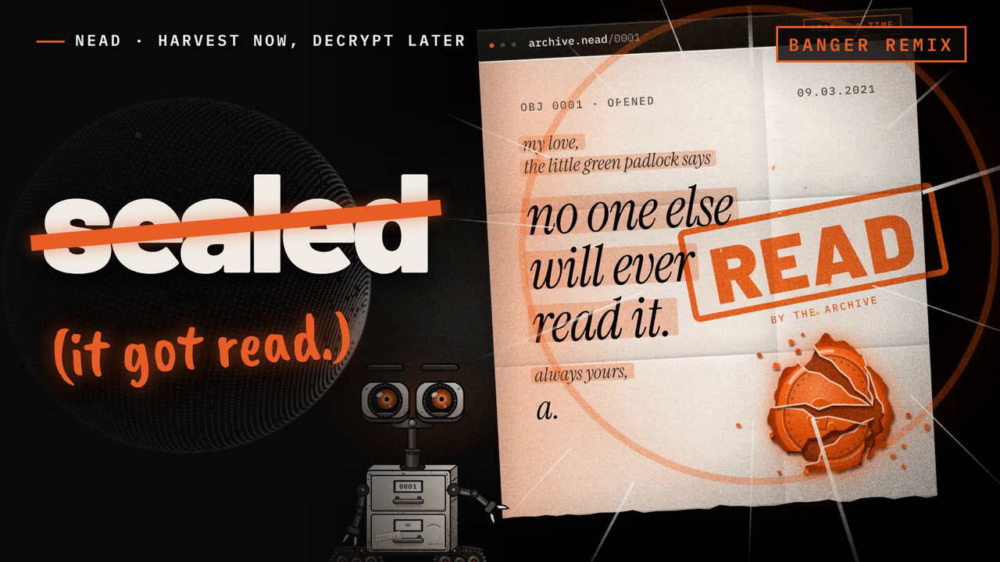
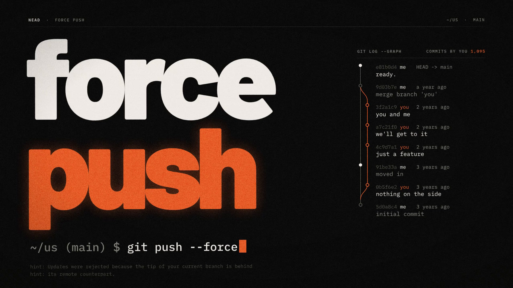

# Neadlab — music videos for NEAD

**A song and its lyric sheet in, a beat-synced lyric video out.** This repository makes the lyric videos for NEAD's
YouTube channel, Neadlab: every lyric appears on the time its word is sung, every hit lands on its beat, and every
image is drawn in code.

<p align="center">
  
  
</p>
<p align="center"><sub>Thumbnails of <i>Harvest Now, Decrypt Later (Banger Remix)</i> and <i>Force Push</i>.</sub></p>

## What makes these videos

- 🎤 **Lyrics on the sung word.** Each word is aligned to the vocal, and appears on screen on its own start time.
- 🥁 **Motion on the beat.** A tracked beat grid, the drum onsets and the song's sections drive every cut and hit.
- ✏️ **Everything is code.** Type, shapes, SVG, canvas and line-drawn 3D, built as
  [HyperFrames](https://hyperframes.heygen.com) compositions (HTML + GSAP). No photos, no stock footage, no
  generated images.
- 🔍 **Measured before it ships.** Every draft is measured against two hit lyric videos and reviewed scene by scene
  by a fresh agent, then refined, before the final render.

## How it works

```mermaid
flowchart LR
    IN["🎵 song + 📝 lyrics"] --> A["1 · Analyze<br/>stems, word timings,<br/>beat grid"]
    A --> B["2 · Interpret<br/>brief, storyboard,<br/>one pun per line"]
    B --> C["3 · Look<br/>stills of key scenes"]
    C -->|"✋ your verdict"| D["4 · Motion<br/>opening + first chorus"]
    D -->|"✋ your verdict"| E["5 · Build<br/>every scene"]
    E --> F["6 · Review loop<br/>measure → critique → refine"]
    F --> G["7 · Deliver<br/>4K master, subtitles,<br/>thumbnails"]
    G --> OUT["📺 out/&lt;id&gt;.mp4"]
```



1. **Analyze** — split the stems, align every sung word, find the beats, bars and sections.
2. **Interpret** — choose the song's world, a literal visual pun for each line, and what builds across the song.
3. **Look** — a few scenes as stills. *The run stops for your verdict.*
4. **Motion** — the opening and first chorus animated and rendered as a proof. *The run stops for your verdict.*
5. **Build** — one agent per scene, three at a time, each checking its own scene.
6. **Review** — render a draft, measure it, have a fresh reviewer score it, fix the weakest scenes (up to two rounds).
7. **Deliver** — the 4K render with the master audio, subtitles, and three thumbnail candidates.

The agents follow [`AGENTS.md`](AGENTS.md), which has every step and its gate. The look is in
[`docs/HOUSE-STYLE.md`](docs/HOUSE-STYLE.md), the checks on a render in
[`docs/visual-guidelines.md`](docs/visual-guidelines.md), the reviewer's brief in [`docs/REVIEW.md`](docs/REVIEW.md),
and why the two reference videos (LGTM, p(doom)) work in [`docs/REFERENCE-VIDEOS.md`](docs/REFERENCE-VIDEOS.md).

## The videos

| Video | Project | Status | Made with |
|---|---|---|---|
| Harvest Now, Decrypt Later (Banger Remix) | [`projects/harvest-remix/`](projects/harvest-remix/) | v22 mastered 2026-10-22 (4K60, `out/harvest-remix.mp4`); v21, the one with a delivery record (`video/DELIVERY.md`), kept as `out/harvest-remix-v21.mp4` | HyperFrames, the approved model of the house style |
| Force Push | [`projects/force-push/`](projects/force-push/) | v2 mastered 2026-10-21 (`out/force-push.mp4`); the light-and-depth rebuild is paused, 7 of 37 scenes done ([`video/LIGHT.md`](projects/force-push/video/LIGHT.md)) | HyperFrames, with the light pass |
| Harvest Now, Decrypt Later | [`projects/harvest/`](projects/harvest/) | published (`out/harvest.mp4`) | the retired three.js engine (git history up to `e4376f8`) |

`out/` is not in the repository; the engine-made Force Push is kept there as `out/force-push-engine.mp4`.

## Quick start

**You need:**

- [bun](https://bun.sh) 1.4 and Node.js (for `npx hyperframes`, pinned to 0.8.164, and the storyboard assembler)
- [uv](https://docs.astral.sh/uv/) and Python ≥ 3.12 for the analysis
- ffmpeg with libx264, libmp3lame and AAC
- in practice an NVIDIA GPU (CUDA through torch) for the analysis and the light pass; the models download a few GB
  of weights into `analysis/.cache/`
- for GPU renders, the Playwright Chrome (`~/.cache/ms-playwright`) windowed on WSLg through `tools/chrome-gpu`;
  without it, add `--no-browser-gpu`

```sh
cd tools && bun install && cd ..   # once

./vid new my-song --audio ~/song.wav --transcript ~/lyrics.txt --title "My Song"
./vid analyze my-song              # stems -> word timings -> beat grid
./vid video my-song                # the HyperFrames project at projects/my-song/video/
#   ... plan and build the scenes with /music-to-video (AGENTS.md) ...
./vid assemble my-song             # index.html from STORYBOARD.md
./vid snap my-song 02-sent --at 12.5,14   # stills of one scene
./vid proof my-song --to 30        # a 60 fps proof of the first 30 s
./vid render my-song --4k          # the whole film
./vid audit my-song --name draft-1 # measure it
./vid master my-song               # out/my-song.mp4, ready to upload
```

## Command reference

All commands run from the repository root. `<id>` is the project's folder name under `projects/`.

| Command | What it does | Writes |
|---|---|---|
| `./vid new <id> --audio <f> --transcript <f> [--title <t>]` | Creates the project; a non-WAV master is also decoded once to a 48 kHz WAV | `projects/<id>/{input,data,work}/`, `project.json` |
| `./vid analyze <id> [--force step,step]` | Runs the [analysis steps](#analysis) whose inputs changed | `data/`, `work/` |
| `./vid status <id>` | Shows each step as current, stale, missing, unrecorded or frozen | — |
| `./vid video <id>` | Scaffolds the HyperFrames project (once) and refreshes the music data; safe to rerun, never touches the brief, storyboard or frames | `video/`, `assets/bgm.mp3`, `audiomap.json`, `lyrics.json`, `assets/kit/env.js` |
| `./vid assemble <id>` | Builds the film from `STORYBOARD.md`, with the overlays on top | `video/index.html` |
| `./vid snap <id> [<frame>] --at <t,…>` | Stills at track seconds, of the film or of one scene alone (then checked with `hyperframes check`) | `video/snapshots/<frame or all>/at-<t>s.png`, `sheet.png` |
| `./vid proof <id> [--from <s>] --to <s>` | A 60 fps proof of a range; `--from` moves back to the start of the scene playing there | `video/renders/proof-<start>-<to>.mp4` |
| `./vid render <id> [--4k]` | The whole film at 60 fps (1080p, or 4K) | `video/renders/video.mp4` |
| `./vid audit <id> [--file <mp4>] [--name <n>]` | Measures a render against the references and per scene (`--file` defaults to the draft, `--name` to the file's name) | `video/audit/<name>/report.md`, `report.json`, `strips/` |
| `./vid master <id>` | The render plus the master's audio (AAC 320k); overwrites the previous master | `out/<id>.mp4` |
| `./vid check [--full]` | The repository gates (see [Checks](#checks)) | — |

`proof` and `render` capture through the GPU (`tools/chrome-gpu`) unless you pass `--no-browser-gpu`. `snap`,
`proof` and `render` then run the light pass, unless you pass `--raw`.

### The light pass

`analysis/finish.py` is the post chain that makes the accent colour glow: bloom and halation on whatever is drawn in
the accent, a little chromatic aberration, a tone shoulder, grain and a vignette. Cream and bone type stay crisp.

- It runs when the project's finish layer (`video/compositions/overlays/finish.html`) names `analysis/finish.py`,
  as the template's does. Force Push uses it; harvest-remix was made before it.
- `STORYBOARD.md`'s frontmatter must name the accent, `light: {"accent": "#E85D26"}`; a scene's `- light: {…}` line
  changes it for that scene.
- The unlit capture is kept beside the result as `<name>.raw.mp4`.

## Repository map

```text
.
├── vid                        the pipeline's entry point (runs tools/vid.ts)
├── AGENTS.md                  how a video is made: the seven stages, for the agents (CLAUDE.md points here)
├── docs/                      house style, visual guidelines, reviewer brief, reference-video analysis, images
├── projects/<id>/             one folder per song
│   ├── project.json           title, audio (the master), transcript (the lyric sheet), frozen steps
│   ├── input/                 the master and the lyric sheet as supplied
│   ├── data/                  the analysis, committed: lines, sections, sung lines, lyrics.json, audio.json
│   ├── tuning.py              hand corrections the analysis cannot detect (optional)
│   ├── video/                 the HyperFrames project: BRIEF, STORYBOARD, SYSTEM, compositions, audit reports
│   └── work/                  stems, model outputs, QA plots (not in the repo; regenerable)
├── analysis/                  Python (uv): stems, alignment, beats, the light pass, the render audit, tests
├── tools/                     TypeScript (bun): vid.ts, the repository checks, chrome-gpu
├── templates/hyperframes/     the house-style kit, vendored three.js and the finish layer, installed by ./vid video
├── successful-videos-reference/analysis/
│                              LGTM and p(doom): per-second metrics, contact sheets, transcripts, YouTube stats;
│                              harvest-remix v12's metrics; the scripts (the videos themselves are not in the repo)
├── .agents/skills/            the HyperFrames skills (linked from .claude/skills/)
└── out/                       the uploads, out/<id>.mp4, and check --full output (not in the repo)
```

## Analysis

Each step runs only when its inputs changed (content hashes in `work/steps.json`; a changed script does not count,
use `--force step,step`). Committed data without a record is adopted, not recomputed; steps listed in
`project.json`'s `frozen` never run.

| Step | Script (`analysis/`) | Writes |
|---|---|---|
| sheet | `lyrics_sheet.py` | `data/lines.txt`, `data/sections.json`: `[Section - note]` headers, or stanzas (a repeated stanza is a chorus) |
| stems | `separate.py` | Demucs htdemucs_ft stems (GPU) |
| vocal | `vocal_feats.py` | vocal pitch, loudness and onsets |
| ctc | `ctc_emissions.py` | MMS_FA and wav2vec2-LV60K emissions on the vocal stem's mono, left and right channel (GPU) |
| whisper | `whisper_run.py turbo` | faster-whisper word timestamps, once without a prompt and once with one (`WHISPER_PROMPT`, or up to 30 of the sheet's words Whisper splits into several tokens) |
| sung | `sung.py` | `data/sung.json`: lines the vocal sings differently from the sheet, kept only when the line's CTC alignment scores at least 8 better and Whisper heard the new words clearly (each ≥ 0.6, mean ≥ 0.8) |
| align | `align.py --plots` | `data/lyrics.json`, a QA plot per line, `work/qa/align_report.md` (words below confidence 0.6 and suspect placements) and `align_flags.json` |
| beats | `analyze.py` | `data/audio.json` |

`analyze.py` detects the tempo window, a constant or tracked grid (tracked when a constant grid's local phase error
spreads over 40 ms), the bar phase and the sections, and records how in `audio.json`'s `detected`. Numbers in the
sheet are aligned as spoken words ("2021" → "twenty twenty one").

What it cannot detect goes into the project's `tuning.py`:

| Setting | What it does |
|---|---|
| `FIX` | Corrects a word's start (and, if needed, its end, syllable starts and confidence) after checking the plots |
| `ANCHORS`, `LINE_WINDOWS` | Pin a word, or a whole line, to a time window in the alignment |
| `PRON` | How a word is pronounced, for the aligner |
| `SUNG` | Lines sung differently from the sheet, set by hand |
| `TEMPO_RANGE`, `GRID`, `BAR_PHASE`, `SECTION_BARS` | Pin the beat analysis instead of detecting it |
| `WHISPER_PROMPT` | Replace Whisper's automatic prompt |
| `EXTRA_DESC`, `ALIGN_NOTES` | Ad-libs and notes written into `lyrics.json` |

Stems and work files are stamped with the master's SHA-256, so a changed master never reuses stale caches.

Inspection tools, all with `--project <id>`: `tempo_probe.py` (tempogram peaks and the search window),
`sections_bars.py` (the section table), `zoom.py 52.8 58.8 zoom_chorus1` (a zoomed spectrogram/pitch/onset plot with
the beat grid; `zoom.py lines 3 4` plots whole lines), `pron.py` (every line's pronunciation) and
`lyrics_sheet.py --check` (the sheet against `data/`).

Harvest's `data/lyrics.json` predates this pipeline (aligned on an mp3 decode with manual corrections that are not
in its `tuning.py`), so its `sung` and `align` steps are frozen: do not re-align it.

## Checks

`./vid check` runs the repository gates: no tracked file over 5 MB outside `projects/*/input/`, the `tools/`
typecheck and tests, Ruff on `analysis/` and the projects' `tuning.py`, and the `analysis/` tests (from
`analysis/tests/`'s own small `uv.lock`: NumPy, CPU torch, pytest, Ruff). CI runs it on every push and pull request
(bun 1.4.2, uv 0.11.21, Python 3.12). To run it before every commit: `git config core.hooksPath .githooks`.

`./vid check --full` also reruns `analyze.py` for every project and requires it to reproduce the committed
`data/audio.json` byte for byte (into `out/check/<id>/`, never over the project's data). It needs the analysis
environment and each project's `work/stems/`, so it runs locally, not in CI.

## Credits

- **Songs:** NEAD.
- **Analysis and pipeline origins:** [mexicat/pdoom-video](https://github.com/mexicat/pdoom-video), MIT.
- **Fonts:** Barlow, IBM Plex Mono, Instrument Serif and Caveat Brush (SIL Open Font License; licenses beside them in
  `projects/*/video/assets/fonts/`).
- **three.js:** vendored in `templates/hyperframes/assets/vendor/` (MIT, license beside it).

## License

The code is released under the [MIT License](LICENSE). The fonts keep their own licenses, and the songs and lyrics
(`projects/*/input/`, `projects/*/data/`) are not covered by it: they belong to their authors.
